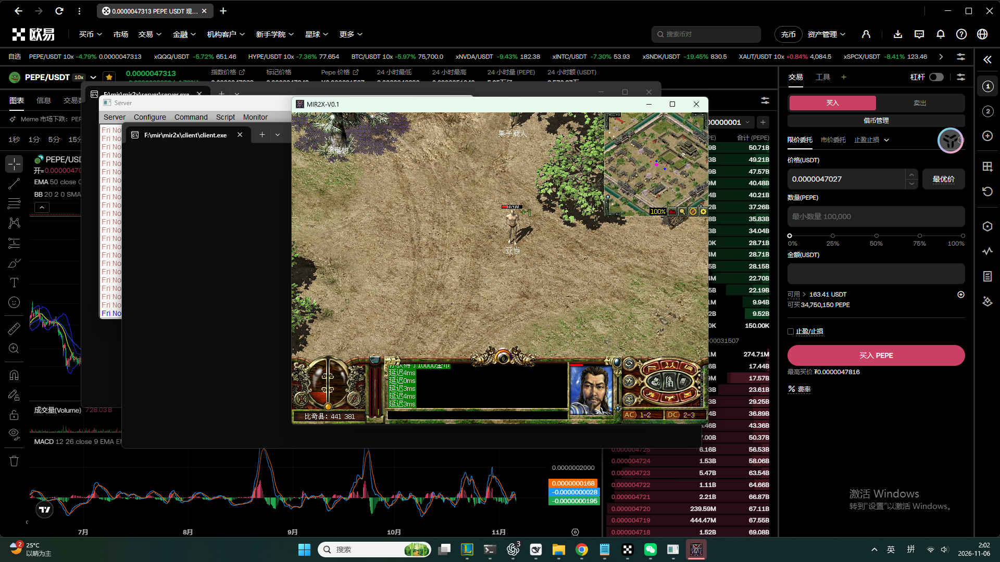

# mir2x Windows 部署工具包

在 Windows 上把 [etorth/mir2x](https://github.com/etorth/mir2x)（开源传奇 2 复刻）跑起来的一套工具、脚本和实测记录。

**实测环境**：Windows 11 专业版 / 8 核 / 32 GB RAM / 全程无 .NET、无 Docker、无数据库依赖 —— mir2x 是静态 C++ 程序，下载解压就能跑。

---

## 这个仓库解决什么

mir2x 官方只给一个 1.26 GB 的构建包，README 里是三条命令。实际部署会卡在这些地方：

| 卡点 | 仓库里的对应 |
|---|---|
| 1.26 GB 单线程只能跑到 0.44 MB/s（约 48 分钟） | `docs/mir2x-部署实录.md` §2.3 的 8 线程 Range 分段脚本，实测 4.6 MB/s |
| 服务端启动后端口不是 README 写的那个 | `--help` 会起在 8000，`--auto-launch` 才是 7000 |
| 服务端日志永远是 0 字节 | 改用 TCP 状态 + SQLite 直查 + 截屏三件套排障 |
| 想加账号，写库直接报 `unknown function: jobValid()` | `tools/add_account.py` 补了 `jobValid` / `SYS_PLY_VIEWR` 两个 UDF 桩 |
| 记不清账号角色对应关系 | `tools/list_accounts.py` 一条命令列出 |
| 想把角色丢到怪堆里测战斗 | `tools/move_char.py` / `heal_char.py` |
| 每次开服要点一堆命令 | `scripts/*.bat` 双击即用 + 桌面快捷方式 |

---

## 快速开始

### 1. 拿安装包

```powershell
$u='https://github.com/etorth/mir2x/releases/download/latest/mir2x-windows-build-201b19d.zip'
$final = & curl.exe -sIL -o NUL -w "%{url_effective}" $u
$len=[int64]1355586003; $n=8; $chunk=[int64][math]::Ceiling($len/$n)
New-Item -ItemType Directory -Force F:\mir\parts | Out-Null
for($i=0;$i -lt $n;$i++){
  $s=[int64]($i*$chunk); $e=[int64][math]::Min($s+$chunk-1,$len-1)
  Start-Process curl.exe -ArgumentList @('-L','--retry','8','--retry-all-errors',
    '--silent','--show-error','--max-time','1800','-r',"$s-$e",'-o',"F:\mir\parts\p$i",$final) -NoNewWindow
}
# 等 8 个 curl 进程全部退出后再合并（判断标准是进程数归零，不是单个文件大小）
& cmd.exe /c ("copy /b " + ((0..7 | ForEach-Object { "F:\mir\parts\p$_" }) -join '+') + " F:\mir\mir2x-win.zip")
(Get-Item F:\mir\mir2x-win.zip).Length   # 必须等于 1355586003
```

### 2. 解压

```powershell
& tar.exe -xf F:\mir\mir2x-win.zip -C F:\mir\mir2x   # 4.7 秒，Win11 自带 bsdtar 比武 Expand-Archive 快得多
```

### 3. 起服务端

```powershell
cd F:\mir\mir2x\server
.\server.exe --auto-launch          # 监听 0.0.0.0:7000
```

首次会弹 Windows 防火墙，点「允许」，否则局域网朋友连不进来。

### 4. 起客户端

```powershell
cd F:\mir\mir2x\client
.\client.exe --server-ip=127.0.0.1 --auto-login=test:123456
```

进游戏，角色「亚当」落在比奇县。



---

## 仓库内容

```
docs/
  mir2x-部署实录.md         完整部署实录：下载/解压/启动/验证证据/9 条踩坑/运维
  传奇私服-自建部署选型.md   上游 30+ 个传奇仓库的部署可行性筛查（哪些能跑、哪些不能）
  怎么玩.txt                 玩家视角的说明书：快捷键、加账号、朋友联机
tools/
  list_accounts.py          列出账号 ↔ 角色 ↔ 地图坐标
  inspect_db.py             导出全库表结构与前 5 行
  dump_schema.py            导出 DDL / 触发器（排查 CHECK 约束用）
  add_account.py            新建账号 + 角色（需停服）
  move_char.py              把角色传送到指定地图坐标
  heal_char.py              改角色 HP
scripts/
  1-启动服务器.bat / 2-开始游戏.bat / 3-停止服务器.bat    双击即用
  start-server.ps1 / start-client.ps1 / stop-server.ps1   带日志与端口就绪检测
mir2x-evidence/             6 张实证截图
```

---

## 已验证 / 未验证

**已验证**（全部有截图或数据库输出佐证）

- 服务端 `0.0.0.0:7000` 监听，客户端 TCP 长连接建立
- 账号登录 → 角色进图（比奇县 / 道馆）
- 建号：写库新增账号+角色 → 登录 → 进图 → 发 10000 金币
- 点击地面行走，服务端坐标持久化
- 怪物 AI 主动攻击，HP `100 → 62 → 4 → 0`，角色死亡并同步渲染
- 经验值影响等级与 HP 上限（`exp=1000000` → 上限 100 → 163）
- 地图切换（map 1 → 24），NPC / 小地图 / HUD 全部跟随刷新
- 双客户端并发连接同一服务端

**未验证**

- 玩家主动攻击怪物（点怪 → 反击 → 怪物死亡 → 掉落经验）—— 卡在输入注入，见下
- 任务系统（接任务 / 交任务）
- 战斗技能（`tbl_learnedmagiclist` 为空，角色出生无技能）

---

## 已知最硬的坑：SDL3 客户端不接受程序化输入

第一个客户端实例上 `PostMessage` 投递 `WM_LBUTTONDOWN` 能驱动走位，之后所有实例全部失效。逐个排除过：

| 方法 | 结果 |
|---|---|
| `PostMessage` WM_LBUTTONDOWN/UP | 首个实例成功，之后全部失败 |
| `mouse_event` 真实事件 | 无效 |
| `SendInput`（返回 1，注入确实成功） | 无效 |
| Alt-key 破前台锁 / `AttachThreadInput` 强制前台 | 无效（`GetForegroundWindow()` 确认是 client） |
| 真实点击标题栏触发 `WM_SETFOCUS` | 无效 |
| 全屏 1904×1041 / 窗口 816×639 | 都无效 |
| 点击角色身边 1–2 格（排除障碍格） | 无效 |

结论：走位判定绑定在实例自身的输入会话状态上，程序化注入只在「刚启动、没被外部搬动过窗口」的实例上偶尔生效。**要自动验证交互，走服务端侧（改库放人、看 AI 行为）；要手动玩，用物理鼠标。**

另一个反直觉的点：`tbl_char` 是**周期刷盘**的，用查库判断「角色有没有动」会得出错误结论，必须看客户端 HUD。

---

## 上游项目状态

mir2x 的 `TODO.md` 明确写了：两条主线任务线 `HonChonDo`（寂幻之刃，25 阶段）和 `HonChonMado`（影魅之刃，11 阶段）**完全没有转换**，且需要先补 6–8 个引擎能力（脚本级 SQL、真实时间调度、跨地图移动 NPC、全服广播、掉落表覆盖、怪物阵营、GroupMove、若干 C++ 绑定）。配套还缺 `D16061`/`D16062` 两张地图、15 个任务道具记录、`阿龙怪` 的怪物记录。

也就是说：**这服能打怪升级，但没有剧情主线。**

详细解读见 `docs/mir2x-部署实录.md` 与上游 `TODO.md`。

---

## 许可

- 本仓库的脚本与文档：MIT
- `etorth/mir2x` 本体：见上游仓库许可
- 游戏美术资源来自上游自绘/重制包，本仓库不包含任何游戏资源文件
