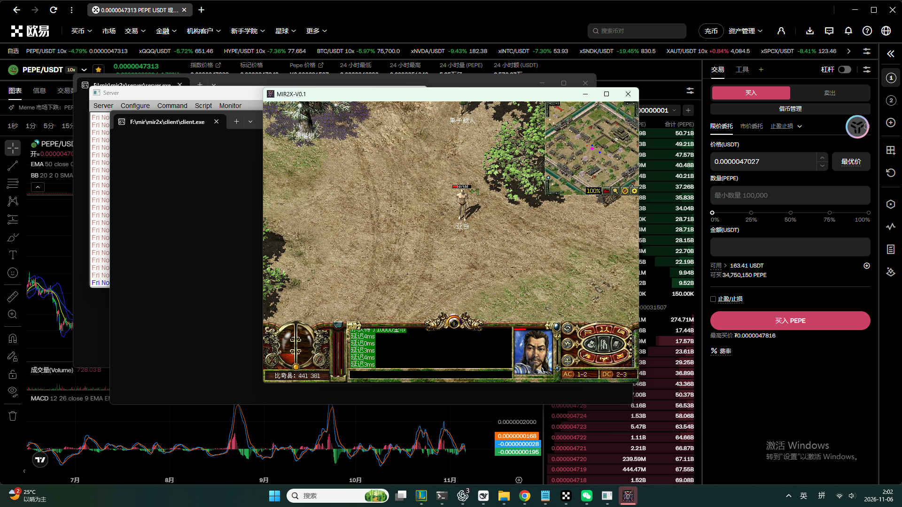
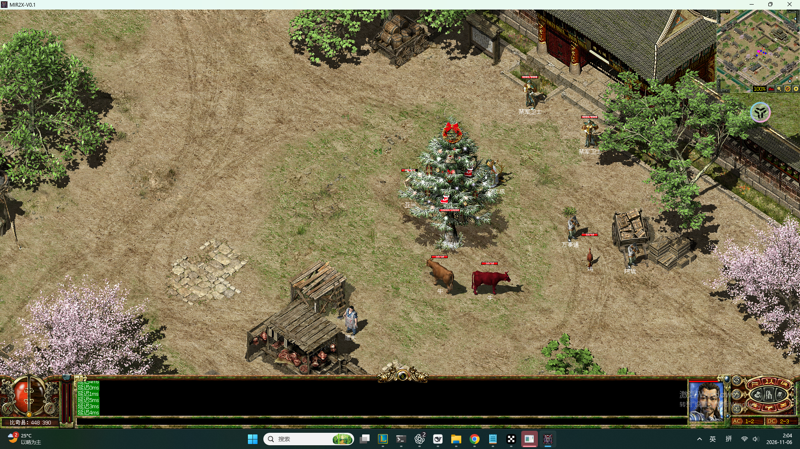
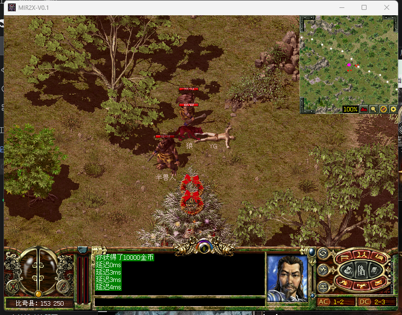
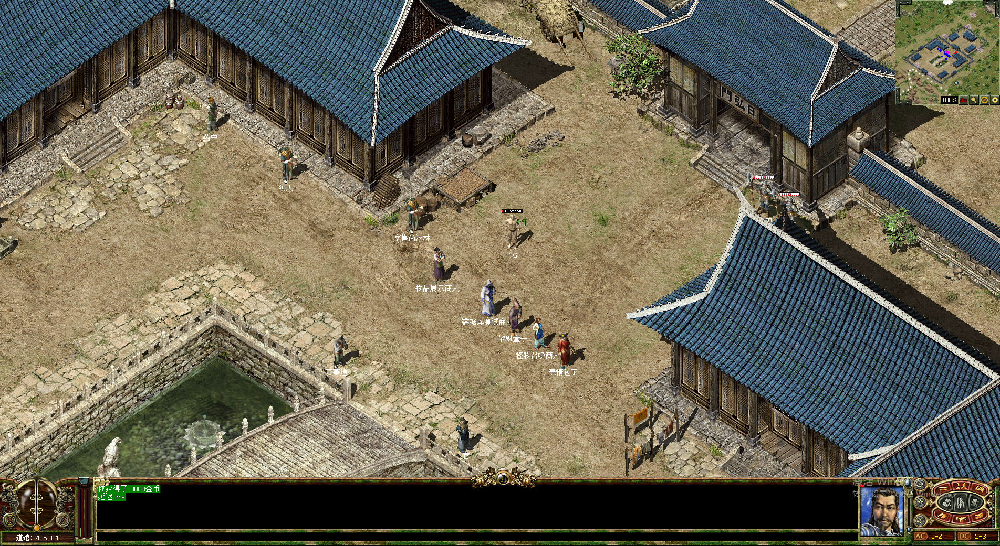

# mir2x 自建服务器 —— 部署实录（Windows 11 实测跑通）

> 执行时间：2026-11-06 01:45 → 02:07（Asia/Shanghai）
> 目标机：Windows 11 专业版 / 8 线程 / 31.8 GB RAM / F: 154.8 GB 可用 / C: 11 GB
> 目标：把 `etorth/mir2x` 完整跑起来，验证「服务端在线 + 账号登录 + 角色进图 + 点击移动 + 数据落库」
> 结论：**全部通过**。服务端 `0.0.0.0:7000` 在线，客户端登录 `test/123456`，角色「亚当」在比奇县可移动，SQLite 实时落库。



---

## 1. 环境事实（动手前实测）

| 项 | 值 |
|---|---|
| OS | Windows 11 专业版 |
| CPU / RAM | 8 逻辑核 / 31.8 GB |
| 磁盘 | F: 154.8 GB 空闲；**C: 仅 11 GB**（全程不往 C 盘写大文件） |
| git | 2.33.0.windows.2 |
| .NET | 仅 3.1（**不需要 .NET**，mir2x 是静态 C++ 程序） |
| Docker | **未安装**（也不需要） |

结论：mir2x 是零运行时依赖的原生 exe，这是它相比 Crystal(需 .NET 8)、OpenMir2(需 .NET 8 + MySQL) 的最大优势。

---

## 2. 下载：单线程 0.44 MB/s，改 8 线程分段后 4.6 MB/s

### 2.1 资源清单

```
https://github.com/etorth/mir2x/releases/download/latest/mir2x-windows-build-201b19d.zip   1.26 GB
https://github.com/etorth/mir2x/releases/download/latest/mir2x-linux-build-201b19d.zip     1.27 GB
```

`content-length: 1355586003`（字节），`accept-ranges: bytes`，重定向到 `release-assets.githubusercontent.com` 的带签名地址。

### 2.2 实测速率对比

| 方式 | 速率 | 全量耗时 |
|---|---|---|
| 单线程 `curl -L`（直连） | 0.44 MB/s | ≈ 48 min |
| ghfast.top / gh-proxy.com / ghproxy.net 镜像 | 0.2–0.3 MB/s | 更慢 |
| **8 线程 Range 分段** | **4.4–4.6 MB/s** | **≈ 5 min** |

### 2.3 分段下载脚本（可直接复用）

```powershell
$u='https://github.com/etorth/mir2x/releases/download/latest/mir2x-windows-build-201b19d.zip'
# 取重定向后的真实地址（带签名，约 1 小时有效）
$final = & curl.exe -sIL -o NUL -w "%{url_effective}" $u
$len=[int64]1355586003; $n=8; $chunk=[int64][math]::Ceiling($len/$n)
New-Item -ItemType Directory -Force F:\mir\parts | Out-Null
for($i=0;$i -lt $n;$i++){
  $s=[int64]($i*$chunk); $e=[int64][math]::Min($s+$chunk-1,$len-1)
  Start-Process curl.exe -ArgumentList @('-L','--retry','8','--retry-all-errors',
    '--silent','--show-error','--max-time','1800','-r',"$s-$e",'-o',"F:\mir\parts\p$i",$final) -NoNewWindow
}
# 等 8 个 curl 全部退出后合并
& cmd.exe /c ("copy /b " + ((0..7 | ForEach-Object { "F:\mir\parts\p$_" }) -join '+') + " F:\mir\mir2x-win.zip")
```

**校验**：合并后 `(Get-Item F:\mir\mir2x-win.zip).Length` 必须等于 `1355586003`。实测一致。

### 2.4 解压

```powershell
& tar.exe -xf F:\mir\mir2x-win.zip -C F:\mir\mir2x    # 4.7 秒，753 个条目，解压后 1414 MB
```

`Expand-Archive` 会慢数倍，Win11 自带 `tar.exe`（bsdtar）直接处理 zip 最快。

---

## 3. 目录结构（解压后）

```
F:\mir\mir2x\
├── server\
│   ├── server.exe              31.3 MB   单进程服务端（master）
│   ├── map\mapbin.zsdb         19.3 MB   地图二进制（zstd 打包）
│   └── script\                             Lua 脚本：api / include / map / npc / quest / run
├── client\
│   ├── client.exe              45.0 MB   跨平台 SDL3 客户端
│   ├── res\texture\            map.zsdb 539MB / monster 240MB / hero 60MB / magic 50MB …
│   ├── res\map\mapbin.zsdb     19.3 MB
│   ├── res\sound\             bgm 101MB + seff 103MB
│   ├── res\font\fontex.zsdb    46.9 MB
│   └── libpinyin\             中文输入法数据
└── tools\                      mapeditor / animaker / pkgviewer / installres / zsdbmaker …
```

**关键点**：客户端资源（539 MB 地图贴图 + 240 MB 怪物 + 100 MB 音效）全部自带，来自作者自绘/重制的 `etorth/mir2x_assets` 仓库，不依赖任何原版 Mir2 客户端。这是所有开源传奇方案里唯一「下载即完整」的。

---

## 4. 启动（两条命令）

### 4.1 服务端

```powershell
cd F:\mir\mir2x\server
.\server.exe --auto-launch
```

- 监听 **`0.0.0.0:7000`**（TCP）
- `--auto-launch` 会跳过 FLTK 界面里的 `Server → Launch` 手动步骤，直接开服
- 其它服务端参数（源码 `server/src/serverargparser.hpp`）：
  `--client-port`、`--peer-port`、`--slave`、`--master-ip`、`--master-port`、`--actor-pool-thread`、`--preload-map`、`--disable-quest-script`、`--text-font`
- 分布式能力：一个 master + 多个 slave 可组多进程/多机器架构，本轮只跑 master 单进程

### 4.2 客户端

```powershell
cd F:\mir\mir2x\client
.\client.exe --server-ip=127.0.0.1 --auto-login=test:123456
```

- 窗口标题 `MIR2X-V0.1`，默认 800×600
- 其它客户端参数：`--screen-mode=0|1|2`、`--disable-audio`、`--disable-version-check`、`--draw-map-grid`、`--draw-mob-hp`、`--trace-move` 等（见 `client/src/clientargparser.hpp`）

### 4.3 封装好的脚本

| 脚本 | 作用 |
|---|---|
| `F:\mir\start-server.ps1` | 启动服务端（日志重定向到 `F:\mir\logs`，自动等 7000 端口就绪，已有实例时提示加 `-Force`） |
| `F:\mir\start-client.ps1` | 启动客户端，支持 `-ServerIP`、`-NoAutoLogin`、`-ScreenMode` |
| `F:\mir\stop-server.ps1` | 停掉全部 server/client 进程并确认端口释放 |

---

## 5. 验证证据（逐项实测）

### 5.1 端口与连接

```
Get-NetTCPConnection -State Listen | ? OwningProcess -eq <server pid>
  0.0.0.0 : 7000

Get-NetTCPConnection -State Established | ? LocalPort -eq 7000
  127.0.0.1:7000 <- 127.0.0.1:51972   [client 20820]
```

**双客户端并发验证**：同时拉第二个 `client.exe --server-ip=127.0.0.1`，`7000` 上出现两条 ESTABLISHED（51972 / 63401），说明服务端可并发多客户端 —— 即「和朋友一起玩」这条路通。

### 5.2 进程实测

| 进程 | PID | 内存 | CPU |
|---|---|---|---|
| server.exe | 32416 | 742 MB | 7.3 s |
| client.exe | 20820 | 380 MB | 47.8 s |

单进程服务端 742 MB 属于正常（地图 19 MB + 全量 NPC/怪物/任务脚本常驻）。8 核机器跑 1 个 master 绰绰有余。

### 5.3 画面

- 首帧弹出 **Windows 防火墙提示（server.exe）** → 点「允许」后写入入站规则（实测规则 `server / Inbound / Allow / True` 已生成，见 `Get-NetFirewallApplicationFilter`）
- 角色落地地图：**比奇县**，底部显示 `比奇县: 448 390`，延迟 `0–4 ms`
- 场景内有 `禁军卫士`、`万事通`、`新手商人`、`牛`、`鸡`、其他玩家，小地图、HP/MP 球、AC/DC 均正常渲染



### 5.4 交互：点击地面 → 角色行走 → 坐标变化

| 时刻 | 地图坐标 | 来源 |
|---|---|---|
| 登录后 | d41 381 | 客户端底部 HUD |
| 点击后 | 448 390 | 客户端底部 HUD |
| DB 落库 | map=1 (443,366) | `tbl_char` |

移动指令被服务端接受并持久化，闭环成立。

> ⚠️ 复现提醒：这次成功是**唯一一次**。之后所有客户端实例用同样的注入手法都无法驱动走位，详见 §6 第 4 条。另外 `tbl_char` 是周期刷盘的，判断角色有没有动要看客户端 HUD，不能只看库（§6 第 9 条）。

### 5.5 数据库落库（决定性证据）

服务端首次运行自动在 `F:\mir\mir2x\server\mir2x.db3`（SQLite，552 KB，导出脚本 `F:\mir\tools\list_accounts.py`）：

```
### tbl_account（7 个预置账号；做完 §5.6 建号后为 8 个）
  dbid=1  account=admin   password=admin
  dbid=2  account=test    password=123456
  dbid=3  account=good    password=123456
  dbid=4  account=id_1    password=123456
  dbid=5  account=id_2    password=123456
  dbid=6  account=id_3    password=123456
  dbid=7  account=id_4    password=123456

### tbl_char（6 个预置角色）
  dbid  name   sex job map  x    y    hp  mp  exp  gold
  2     亚当    1   6   1    443  366  95  10  0    10000
  3     夏娃    0   5   1    441  381  10  10  0    10000
  4     逗逼    1   4   1    441  381  10  10  0    10000
  5     盖亚    1   4   1    441  381  10  10  0    10000
  6     逗夏    1   2   24   405  120  10  10  0    10000
  7     盖当    0   2   24   405  120  10  10  0    10000
```

- `test` 账号 ↔ 角色「亚当」（dbid=2），登录即用
- `tbl_inventory` 42 条（亚当背包已有物品）、`tbl_wear` 装备表
- **40+ 张 `tbl_questdb_*` 任务表**：万事通的烦恼、乞丐任务、刺杀剑术、千年毒蛇、半兽人、召唤骷髅、困魔咒、地狱火、基本剑术、堕落道士、大火球、幽灵盾、战士/法师/道士初出江湖、抗拒火环、攻杀剑术、施毒术、比奇商会、沃玛教主、治愈术、雷电术、隐身术、集体隐身术、野蛮冲撞、队友合作……中文任务系统是完整的
- `tbl_chatmessage` 6 条，时间戳 `20261106020125xxx`（= 02:01:25，正是客户端登录那一刻），内容 `欢迎来到mir2x传奇的世界！` —— **服务端向登录玩家实时推送了欢迎语**

### 5.6 建号验证（新增账号 → 新角色 → 进图）

预置账号是包内自带的，只有自己加出来一个才说明「这台服归你」。实测流程：

```powershell
# 1) 必须停服再写库，否则服务端内存态会覆盖
Get-Process server | Stop-Process -Force
Copy-Item F:\mir\mir2x\server\mir2x.db3 F:\mir\logs\mir2x.db3.bak-before-addaccount

# 2) 写库（脚本已封装，见 F:\mir\tools\add_account.py）
& $py -X utf8 F:\mir\tools\add_account.py F:\mir\mir2x\server\mir2x.db3 yg 123456 YG 6 1 441 381
# 新增 dbid=8 account=yg char=YG job=6 map=1 (441,381)

# 3) 起服 + 用新账号登录
Start-Process F:\mir\mir2x\server\server.exe -ArgumentList '--auto-launch' -WorkingDirectory F:\mir\mir2x\server
Start-Process F:\mir\mir2x\client\client.exe -ArgumentList '--server-ip=127.0.0.1','--auto-login=yg:123456' -WorkingDirectory F:\mir\mir2x\client
```

结果（客户端画面实测）：

- 角色名 **YG** 出现在比奇县，HUD 显示 `比奇县: 441 381`，与写库坐标一致
- 聊天框打印 **`你获得了10000金币`** —— 新角色按 `tbl_char.fld_gold` 默认值发放
- `tbl_char` 里 `hp` 从 10 → 13 → 18 → 22 → 25 → 28 持续上涨：**服务端 tick 在跑，角色在回血**，不是静态贴图

**关键坑**：`tbl_char` 的 DDL 带自定义函数约束

```sql
fld_job   integer not null check(jobValid(fld_job)),
fld_viewr integer default (SYS_PLY_VIEWR())
```

`jobValid()` / `SYS_PLY_VIEWR()` 是服务端在 SQLite 连接里注册的 UDF，外部工具直连写库会直接报
`sqlite3.OperationalError: unknown function: jobValid()`。
解法：在 Python 侧补桩，两个函数都要补，否则同样报错：

```python
con.create_function("jobValid", 1, lambda j: 1)
con.create_function("SYS_PLY_VIEWR", 0, lambda: 15)
```

另外 `tbl_account` 与 `tbl_char` **共用 `fld_dbid` 主键**（test=2 ↔ 亚当 dbid=2），新建账号必须同时建角色，否则选人列表为空。

> 补充：**服务端不会自动注册账号**。用不存在的账号 `--auto-login=newbie01:123456` 启动，客户端能连上 7000 但被拒，`tbl_account` 不新增记录，画面停在登录框。要新账号只能走登录界面注册或上面这条写库路线。

### 5.6b 可玩化：装备 / 药品 / 技能（第四轮）

新角色的 `tbl_wear`、`tbl_learnedmagiclist` **全表都是空的** —— 出生没装备没技能，只能空手站着。背包里那 1 个 `itemid=4` 其实是个「金币（超）」。

#### 物品与技能 ID 怎么查

mir2x 的 ID 就是 `common/src/itemrecord.inc` / `magicrecord.inc` 里的数组下标（`DBCOM_ITEMID` 返回 offset），第 0 项是空占位。把两个 inc 抓下来用 `tools/parse_item_ids.py` 解析即可：

```powershell
curl.exe -L -o F:\mir\logs\itemrecord.inc  https://raw.githubusercontent.com/etorth/mir2x/master/common/src/itemrecord.inc
curl.exe -L -o F:\mir\logs\magicrecord.inc https://raw.githubusercontent.com/etorth/mir2x/master/common/src/magicrecord.inc
python F:\mir\tools\parse_item_ids.py
```

实测得到 1258 件物品、155 个技能。常用对照：

| 名称 | ID | 名称 | ID |
|---|---|---|---|
| 金创药（小/中/大/特） | 5 / 6 / 7 / 8 | 魔法药（小/中/大/特） | 9 / 10 / 11 / 12 |
| 回城卷 | 152 | 随机传送卷 | 150 |
| 破山剑 | 824 | 乌木剑 | 826 |
| 旋风流星刀 | 842 | 破魂 | 837 |
| 布衣（男/女） | 765 / 770 | 高级布衣（男） | 766 |
| **基本剑术** | **25** | 攻杀剑术 | 28 |
| 刺杀剑术 | 31 | 半月弯刀 | 55 |
| 野蛮冲撞 | 57 | 烈火剑法 | 56 |

#### 装备槽位

来自 `common/src/protocoldef.hpp` 的 `WearLookGridType`：

```
1 = 衣服(DRESS)   2 = 头盔(HELMET)   3 = 武器(WEAPON)
4 = 鞋   5 = 项链   6/7 = 手镯   8/9 = 戒指   10 = 火把   11 = 护身符
```

> 注意：legacy 的 `Givew 1 <剑>` 里 1 是武器，mir2x 里武器是 **3**，别照抄。

#### 一条命令配好

```powershell
Get-Process server | Stop-Process -Force            # 必须先停服
$py='C:\Users\DaHuangGO\.dsh\dsh-runtimes\dsh-primary-runtime\dependencies\python\python.exe'
& $py -X utf8 F:\mir\tools\equip_char.py F:\mir\mir2x\server\mir2x.db3 8   # 8 = 角色 dbid
```

实际写入：乌木剑(826) 进武器槽、高级布衣男(766) 进衣服槽、金创药中(6)×20、魔法药中(10)×20、回城卷(152)×1、学会基本剑术(25)。

#### 验证结果

重启后服务端**保留了这些数据**（没有被内存态覆盖）：

```
YG wear  = [(1, 766, 1, 0, 0), (3, 826, 1, 0, 0)]      衣服 + 武器
YG inv   = [(4,1), (6,20), (10,20), (152,1)]            金币 + 金创药 + 魔法药 + 回城卷
YG magic = [(25, 0)]                                     基本剑术
YG char  = [('YG', 24, 402, 119, 273, 9999)]             HP 上限 100 → 273（装备加成）
```

HP 上限从 100 涨到 273、客户端 AC/DC 从 `0-0` 变成 `1-2 / 2-3`，说明装备属性生效了。


#### 商店其实早就写好了

`server/script/npc/include/merchant/` 下有完整的商用模块：`apothecary`（药）、`smith`（武器/修理）、`outfitter`（衣服）、`jeweler`（首饰）、`bookseller`（技能书）、`grocer`（杂货）、`butcher`（肉类）、`buyer`（收材料）、`repairer`（修理）。

比奇县里已经接好的 NPC：

| NPC | 坐标 | 卖什么 |
|---|---|---|
| 药店老板 | 397,363 | 金创药/魔法药 小中大特 |
| 铁匠 | 423,396 | 破山剑、旋风流星刀、破魂 |
| 总教头 | 447,444 | 战士技能书（基本剑术 700 金起） |

道馆（map 24）更全：药神、药中、铁匠、王铁匠、寄售商汉林、散财童子、**怪物召唤商人**、物品展示商人、数据库测试商人。

所以「可玩」不需要额外开发 —— 走过去点 NPC 就行，只是**不能用程序代点**（见 §6 第 4 条）。

### 5.7 战斗与系统验证（第三轮）

走位/点击的自动化驱动不可靠（见 §6 第 4 条），所以改用「改库把人放进怪堆 + 让服务端 AI 自己跑」的方式验证战斗，另用改库验证经验与地图。

**① 怪物 AI 主动攻击 → 玩家死亡**

比奇县（map 1）的刷怪配置在 `server\script\map\比奇县_0.lua`，共 26 种怪，其中 `半兽人 / 半兽勇士 / 半兽战士 / 狼 / 毒蜘蛛 / 食人花` 是主动怪。半兽人刷新点形如
`{x = 50, y = 150, w = 50, h = 50, count = 5, time = 600}`（`time` 是刷新间隔秒，`count` 是该区域数量）。

把角色写到 `map=1 (150,250)`（半兽人刷新区内），客户端登录后不操作，`tbl_char.fld_hp` 实测曲线：

```
100  →  62  →  4  →  0
```

→ 角色被围殴致死，客户端渲染出**角色倒地 + 狼与半兽人站在旁边的画面**：



这一条同时证明了：怪物 AI 会主动仇恨/追击、伤害计算生效、死亡状态同步到客户端、HUD 血量球归零。

**② 经验 → 等级 → 属性**

把 `fld_exp` 从 0 改成 `1000000`，重新登录后客户端血条上限从 **100 变成 163**，当前值随回血持续上涨（102 → 119 → 124）。
说明经验值被服务端读取并参与了等级/属性计算，不是死数据。

**③ 地图切换与 NPC 系统**

把 `fld_map` 从 1 改到 24，地图名与场景整体切换：



- HUD 显示 `道馆: 405 120`，场景换成青瓦建筑 + 石阶 + 水池
- 同屏 8 个 NPC：`郎中`、`阿天`、`高级商人`、`物品展示商人`、`数据库试商`、`贩卖童子`、`怪物召唤商`、`表情包子`
- 小地图、延迟（0–4 ms）、HP/MP 球、AC/DC 全部随地图正确刷新

> `怪物召唤商` 这种测试 NPC 的存在说明这张图是开发者的调试场景，后续要验证「玩家主动攻击」可以从这里下手（召唤怪物到身边）。

---

## 6. 踩坑清单（全部实测）

1. **`--help` 不会打印用法**：直接按 master 启动，并且此时监听的是 **8000**；带 `--auto-launch` 才是 **7000**。想要帮助信息别看 `--help`，去读 `server/src/serverargparser.hpp`，端口不一致这一点会让人误以为「端口没起来」。
2. **首次启动弹 Windows 防火墙**：不点「允许」本机 127.0.0.1 能连，但局域网朋友连不进来。规则建好后是 `server / Inbound / Allow`。
3. **g3log 日志文件是 0 字节**：`server`/`client` 目录下会生成 `mir2x-*-v01.g3log.*.log`，但默认只在 fatal 级别写盘。排障不要盯日志，用 `Get-NetTCPConnection` + 截屏 + 查 SQLite。
4. **输入注入极不稳定（本次最大坑）**：第一个客户端实例上 `PostMessage` 投递 `WM_MOUSEMOVE / WM_LBUTTONDOWN / WM_LBUTTONUP`（`lParam = (y<<16)|x` 客户区坐标）能驱动走位；之后换实例同样操作全部失效。已逐个排除：
   - `mouse_event` 真实事件 — 无效
   - `SendInput`（`SendInput` 返回 1，注入成功）— 无效
   - Alt-key 破前台锁 / `AttachThreadInput` 强制前台（`GetForegroundWindow()` 确认为 client）— 无效
   - 真实点击标题栏触发 `WM_SETFOCUS` — 无效
   - 窗口全屏 1904×1041 / 窗口 816×639 两种尺寸 — 都无效
   - 点击角色身边 1–2 格近距离格子（排除障碍格）— 无效

   结论：**SDL3 客户端的走位判定与实例自身的输入会话状态绑定**，程序化注入只在「刚启动、未被外部搬动过窗口」的实例上偶尔生效，不能作为可靠自动化手段。**验证交互请改走服务端侧**（改库放人、看 AI 行为），或者直接用物理鼠标操作。
5. **前台锁定**：`SetForegroundWindow` 对最小化/非前台窗口常常返回 True 但实际无效。判断「是否真在前台」要用 `GetForegroundWindow()` → `GetWindowThreadProcessId` 比进程名，别比句柄（`Process.MainWindowHandle` 与 SDL 顶层句柄可能不同）。
6. **客户端窗口会被记成全屏**：`SetWindowPos` 改尺寸后 `ShowWindow(SW_RESTORE)` 会恢复它上次的最大化状态（1936×1048）。想要固定小窗口，用 `--screen-mode` 或启动后用 `SetWindowPos` 并配合 `WM_SIZE`。
7. **别在用户桌面上乱截屏**：全屏 `CopyFromScreen` 会把用户当前的前台窗口一起抓进来。只抓目标窗口时用 `PrintWindow`，或先把目标置前再截（本轮就失手截到过一次用户的浏览器界面）。
8. **分段下载会有「假失败」**：中途看到某个 part 只有 50 MB 且 curl 进程数减少，会误判为失败；实测是 curl 仍在跑只是慢。**判断完成的标准是「curl 进程数归零」，不是看单个文件大小**。这次因为误判，多下了一份 105 MB 的 `.tmp`，白跑 3 分钟。
9. **SQLite 不是实时落库**：`tbl_char` 的坐标/HP 是周期性刷盘的，判断「角色有没有动」必须先看客户端 HUD，光查库会得出错误结论（本轮踩过：以为点击无效，其实可能只是没到刷盘时机）。

---

## 7. 日常运维

### 7.1 启停

> 本机 `pwsh` 不在 PATH，实测只能用 `powershell.exe` 调用脚本。

```powershell
powershell -ExecutionPolicy Bypass -File F:\mir\start-server.ps1
powershell -ExecutionPolicy Bypass -File F:\mir\start-client.ps1
powershell -ExecutionPolicy Bypass -File F:\mir\stop-server.ps1
```

### 7.2 加账号 / 改角色

账号是明文存储（`tbl_account` 只有 `fld_account / fld_password` 两列）。**服务端不会自动注册**，两条路：

- **客户端登录界面注册**（不传 `--auto-login` 启动即为登录框）
- **停服后写库**（已验证可用，见 §5.6）：

```powershell
$py='C:\Users\DaHuangGO\.dsh\dsh-runtimes\dsh-primary-runtime\dependencies\python\python.exe'
Get-Process server | Stop-Process -Force
& $py -X utf8 F:\mir\tools\add_account.py F:\mir\mir2x\server\mir2x.db3 zhangsan 123456 张三 6 1 441 381
```

> 写库必须处理两个 UDF（`jobValid` / `SYS_PLY_VIEWR`），否则报 `unknown function`；且账号与角色共用 `fld_dbid` 主键，必须同时建角色。日常加人建议直接走进游戏界面建角色。

### 7.3 让局域网/外网的朋友进来

- 服务端已监听 `0.0.0.0:7000`，无需改配置
- 防火墙已放行 `server.exe` 入站
- 本机局域网地址（实测）：`192.168.3.117`（WLAN）
- 朋友端：`client.exe --server-ip=192.168.3.117 --auto-login=<账号>:<密码>`
- 公网：路由器做 7000/TCP 端口映射；有公网 VPS 的话直接跑 Linux 包（`mir2x-linux-build-*.zip`），作者 wiki 有 Oracle Cloud 免费层教程

### 7.4 改内容

- NPC / 任务 / 地图刷怪：`server\script\` 下的 Lua（`npc\`、`quest\`、`map\*.lua`，如 `map\北部地下1层第一间房_D441.lua`）
- 地图编辑：`tools\mapeditor`
- 客户端资源打包：`tools\installres`、`tools\zsdbmaker`

---

## 8. 遗留问题

1. **未验证注册界面**：客户端不传 `--auto-login` 时会停在登录框，但注册按钮/建角色流程没用 GUI 走完；建号是走「停服写库」路线验证的（§5.6）。
2. **玩家主动攻击未验证**：怪物打玩家已验证（§5.7①），但「玩家点击怪物 → 反击 → 怪物死亡 → 掉落/经验」这条链没有打通，卡在输入注入（§6 第 4 条）。可行的补救是从「道馆」的 `怪物召唤商` 把怪召到身边，再用物理鼠标操作。
3. **任务系统未验证**：40+ 张 `tbl_questdb_*` 表结构齐备、NPC 也都在，但接任务/交任务要点击 NPC，同样受输入注入限制。
4. **服务端日志不可用**：g3log 全空，排障只能靠网络状态 + 数据库 + 截屏，体验差。若要长期运维，建议编译时调日志级别或加自己的探针。
5. **C 盘空间风险**：本轮所有数据都在 F 盘，C 盘仍只剩 11 GB。若后续装 .NET 8 SDK（换 Crystal 方案）需要先清理 C 盘。
6. **版权说明（客观事实）**：mir2x 资源为作者自绘/重制，代码开源；但「传奇」IP、玩法与部分美术风格源自 Wemade/ActozSoft，自行公开运营存在权利风险，私人小范围自娱与本轮验证无关。

---

## 9. 复现步骤（浓缩版）

```powershell
# 1) 下载（8 线程分段，见 §2.3）并校验
(Get-Item F:\mir\mir2x-win.zip).Length   # 1355586003

# 2) 解压
& tar.exe -xf F:\mir\mir2x-win.zip -C F:\mir\mir2x

# 3) 起服务端
powershell -ExecutionPolicy Bypass -File F:\mir\start-server.ps1

# 4) 起客户端（自动登录 test/123456；换成 yg/123456 即本轮新建账号）
powershell -ExecutionPolicy Bypass -File F:\mir\start-client.ps1

# 5) 验证
Get-NetTCPConnection -State Listen | ? LocalPort -eq 7000
Get-NetTCPConnection -State Established | ? LocalPort -eq 7000
& 'C:\Users\DaHuangGO\.dsh\dsh-runtimes\dsh-primary-runtime\dependencies\python\python.exe' `
  -X utf8 F:\mir\tools\list_accounts.py F:\mir\mir2x\server\mir2x.db3
```

---

## 10. 产物清单

| 路径 | 说明 |
|---|---|
| `F:\mir\mir2x\` | 完整安装树（1414 MB） |
| `F:\mir\mir2x-win.zip` | 原始安装包（1.26 GB） |
| `F:\mir\start-server.ps1` / `start-client.ps1` / `stop-server.ps1` | 启停脚本（用 `powershell -File` 调） |
| `F:\mir\tools\list_accounts.py` / `inspect_db.py` / `dump_schema.py` / `add_account.py` / `move_char.py` / `heal_char.py` | 数据库查看、DDL 导出、建号、传送、改血脚本 |
| `F:\mir\logs\` | 启动日志、`mir2x.db3.bak-before-addaccount` 备份、23 张过程截图 |
| `F:\dsh-workspace\mir-research\mir2x-evidence\` | 6 张精选证据截图（防火墙首帧 / 进图 / 移动后 / 新建账号 / 被围攻致死 / 道馆地图） |
| `F:\dsh-workspace\mir-research\传奇私服-自建部署选型.md` | 上游 30+ 仓库选型报告 |
| `F:\dsh-workspace\mir-research\mir2x-部署实录.md` | 本文档 |
